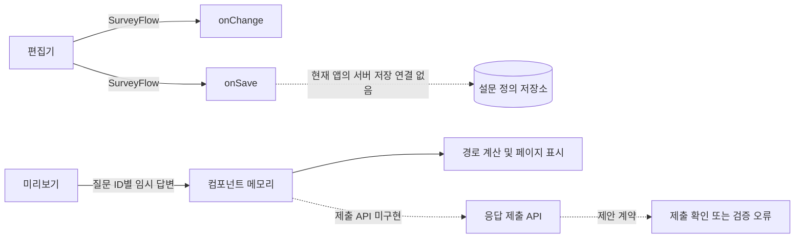
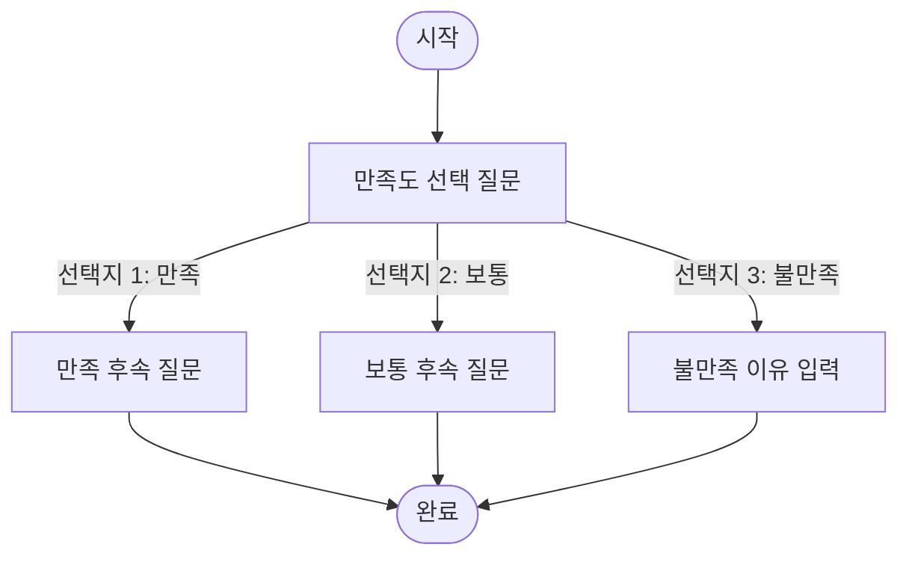

# 설문 흐름 데이터 구조와 요청·응답 계약

## 1. 범위와 구현 상태

설문 흐름 편집기는 **질문지 정의**를 편집하고, 미리보기 중에는 **응답 임시값**을 메모리에 보관합니다. 현재 `SurveyFlowEditor`에는 설문 정의의 `onChange`·`onSave` 콜백은 있지만, 응답 제출 API나 서버 저장은 연결되어 있지 않습니다.

따라서 이 문서는 구조를 다음처럼 구분합니다.

| 구분 | 현재 상태 | 데이터 |
|---|---|---|
| 설문 정의 | 구현됨 | 제목, 노드, 연결선 |
| 미리보기 응답 | 구현됨, 컴포넌트 메모리 내 임시값 | 질문 ID별 답변 |
| 응답 제출 요청·서버 응답 | 미구현 | 아래 API 예시는 제안 계약 |

현재 노드 종류는 `start`, `question`, `page`, `end`입니다.

## 2. 전체 데이터 흐름



자동 정렬, 화면 위치와 선택 상태는 응답 데이터가 아닙니다. 설문 정의를 저장할 때 노드의 `position`은 포함되며, 응답 제출에는 포함하지 않습니다.

## 3. 설문 정의 데이터

### 3.1 최상위 구조

실제 타입은 `SurveyFlow`입니다.

```ts
type SurveyFlow = {
  title?: string;
  nodes: SurveyFlowNode[];
  edges: SurveyFlowEdge[];
};
```

편집기의 `onChange(flow)`와 저장 버튼의 `onSave(flow)`는 이 형태를 전달합니다. 저장 버튼은 흐름 유효성 검사를 통과해야 콜백을 호출합니다. 현재 Storybook 예제에는 서버 저장 콜백이 구현되어 있지 않습니다.

### 3.2 노드 종류

| `data.kind` | 역할 | 주요 필드 |
|---|---|---|
| `start` | 설문 시작 | `title` |
| `question` | 응답을 받는 질문 | `title`, `questionType`, `options` |
| `page` | 미리보기 질문을 페이지로 나누는 경계 | `title` |
| `end` | 설문 종료 | `title` |

공통 노드는 `id`, `type`, `position`, `data`를 가집니다. 질문 유형은 `single`, `multiple`, `text`입니다. `options`는 선택형 질문의 선택지 배열이며, 직접 입력형 질문에서는 사용하지 않습니다.

### 3.3 노드 예시

```json
{
  "id": "q-satisfaction",
  "type": "question",
  "position": { "x": 320, "y": 180 },
  "data": {
    "kind": "question",
    "title": "전반적인 만족도를 선택해 주세요.",
    "questionType": "single",
    "options": ["만족", "보통", "불만족"]
  }
}
```

경로를 나누려면 선택형 질문의 선택지 출력 핸들을 다음 질문에 연결합니다. 별도 분기 노드는 만들지 않습니다.

현재 데이터 타입에는 필수 여부, 도움말, 응답 검증 규칙, 질문 순번용 별도 필드가 없습니다. 그런 속성은 임의로 추가되어도 현재 계약에서 지원된다고 볼 수 없습니다.

### 3.4 연결선

연결선은 노드 간 흐름과 선택지별 분기를 정의합니다.

```json
{
  "id": "e-dissatisfied-reason",
  "source": "q-satisfaction",
  "sourceHandle": "option-2",
  "target": "q-reason",
  "targetHandle": "top",
  "type": "default"
}
```

| 연결 출발점 | 핸들 예시 | 의미 |
|---|---|---|
| 단일·복수 선택 질문 | `option-0`, `option-1` | 해당 선택지를 골랐을 때 연결된 경로 |
| 텍스트 질문 | `bottom` | 텍스트 질문 다음 경로 |
| 시작·페이지 노드 | `bottom` | 다음 노드로 이어지는 경로 |

선택지 인덱스는 0부터 시작합니다. 예시의 `option-2`는 세 번째 선택지인 “불만족”입니다. `page` 노드는 연결 그래프에 존재하지만 응답값을 만들지 않습니다.

### 3.5 저장용 설문 정의 예시

```json
{
  "title": "고객 만족도 조사",
  "nodes": [
    {
      "id": "start",
      "type": "start",
      "position": { "x": 320, "y": 40 },
      "data": { "kind": "start", "title": "설문 시작" }
    },
    {
      "id": "q-satisfaction",
      "type": "question",
      "position": { "x": 320, "y": 160 },
      "data": {
        "kind": "question",
        "title": "만족도를 선택해 주세요.",
        "questionType": "single",
        "options": ["만족", "보통", "불만족"]
      }
    },
    {
      "id": "q-reason",
      "type": "question",
      "position": { "x": 560, "y": 320 },
      "data": {
        "kind": "question",
        "title": "불만족한 이유를 적어 주세요.",
        "questionType": "text"
      }
    },
    {
      "id": "end",
      "type": "end",
      "position": { "x": 320, "y": 480 },
      "data": { "kind": "end", "title": "설문 완료" }
    }
  ],
  "edges": [
    { "id": "e-start", "source": "start", "sourceHandle": "bottom", "target": "q-satisfaction", "targetHandle": "top" },
    { "id": "e-dissatisfied", "source": "q-satisfaction", "sourceHandle": "option-2", "target": "q-reason", "targetHandle": "top" },
    { "id": "e-reason-end", "source": "q-reason", "sourceHandle": "bottom", "target": "end", "targetHandle": "top" }
  ]
}
```

## 4. 응답 데이터

### 4.1 현재 미리보기 구조

현재 미리보기의 응답 상태는 다음 타입입니다.

```ts
type PreviewResponses = Record<string, string | string[]>;
```

질문 ID가 키이고, 선택/입력한 값이 값입니다.

| 질문 유형 | 값 타입 | 예시 |
|---|---|---|
| 단일 선택 | 문자열 | `"만족"` |
| 복수 선택 | 문자열 배열 | `["배송", "가격"]` |
| 텍스트 입력 | 문자열 | `"배송 안내가 늦었어요."` |
| 미응답 | 키 없음 | `{}` 또는 일부 질문 키 누락 |

질문 유형을 구분하는 정보는 설문 정의에 있으므로, 응답 객체에는 `questionType`을 반복해서 넣지 않습니다.

### 4.2 조합 예시

**단일 선택만 응답**

```json
{
  "q-satisfaction": "만족"
}
```

**복수 선택과 텍스트 입력**

```json
{
  "q-features": ["검색", "알림"],
  "q-comment": "검색 결과를 저장할 수 있으면 좋겠어요."
}
```

**분기 후 해당 경로의 질문에 응답**

```json
{
  "q-satisfaction": "불만족",
  "q-reason": "배송이 늦었어요."
}
```

분기에서 선택하지 않은 경로의 질문 ID는 정상 제출 데이터에 넣지 않는 것을 제안합니다. 현재 미리보기는 응답 상태를 `responses` 객체로 보관하고, 그 값을 사용해 질문 경로와 페이지를 계산합니다. 답변 완료 여부를 확인하는 별도의 제출 기능은 아직 없습니다.

## 5. 제안하는 요청·응답 계약

아래 HTTP API와 서버 응답은 **현재 구현이 아니라 제출 기능을 추가할 때의 제안**입니다.

### 5.1 설문 정의 저장

| 방향 | 본문 |
|---|---|
| 요청 | `SurveyFlow` 전체 (`title`, `nodes`, `edges`) |
| 성공 응답 | 저장된 `surveyId`, 버전, 수정 시각 등 서버 메타데이터 |
| 실패 응답 | 제목/노드/연결선 유효성 오류 |

### 5.2 응답 제출

**요청 제안**

```http
POST /api/surveys/{surveyId}/responses
Content-Type: application/json
```

```json
{
  "responses": {
    "q-satisfaction": "불만족",
    "q-reason": "배송이 늦었어요."
  }
}
```

**성공 응답 제안**

```json
{
  "responseId": "response-1001",
  "surveyId": "survey-001",
  "status": "submitted",
  "submittedAt": "2026-10-17T10:05:00+09:00"
}
```

`responseId`와 제출 시각은 서버가 발급하는 메타데이터이며, 질문 답변과 분리합니다. 응답자 정보나 추적 정보가 필요하다면 개인정보 정책과 제품 요구사항에 따라 별도 필드를 정의해야 합니다.

질문 유형과 경로에 따른 요청 조합은 다음과 같습니다. 모든 예시는 같은 `responses` 필드 안에 담깁니다.

| 조합 | 요청의 `responses` 예시 | 의미 |
|---|---|---|
| 단일 선택 | `{"q1":"만족"}` | 선택값 한 개 |
| 복수 선택 | `{"q2":["배송","가격"]}` | 선택값 여러 개 |
| 직접 입력 | `{"q3":"배송 안내가 늦었어요."}` | 자유 입력 문자열 |
| 여러 질문 혼합 | `{"q1":"만족","q2":["검색","알림"],"q3":"편리했어요."}` | 질문 ID별 값의 합집합 |
| 분기 경로 | `{"q-satisfaction":"불만족","q-reason":"배송이 늦었어요."}` | 선택한 경로의 질문만 포함 |
| 일부 미응답 | `{"q1":"만족"}` | 미응답 질문 ID는 생략; 허용 여부는 제출 검증 정책으로 정해야 함 |

정상 제출이라면 각 조합은 공통 성공 응답을 받을 수 있습니다.

```json
{
  "responseId": "response-1004",
  "surveyId": "survey-001",
  "status": "submitted",
  "submittedAt": "2026-10-17T10:15:00+09:00"
}
```

### 5.3 검증 실패 응답 제안

```http
400 Bad Request
```

```json
{
  "status": "invalid",
  "errors": [
    {
      "questionId": "q-satisfaction",
      "code": "INVALID_OPTION",
      "message": "등록된 선택지 중 하나를 선택해야 합니다."
    }
  ]
}
```

현재 설문 정의에는 필수 여부 필드가 없으므로 `REQUIRED` 오류를 제공하려면 먼저 필수 여부를 정의 구조에 추가해야 합니다. 그 전까지 필수 응답 검증은 계약에 포함하지 않습니다.

## 6. 선택지 경로 조합



예를 들어 “불만족” 경로를 택하면 요청의 `responses`는 `q-satisfaction`과 `q-reason`을 포함합니다. “만족” 경로를 택하면 `q-satisfaction`과 `q-satisfied-followup`을 포함합니다. 경로 선택은 조건 노드가 아니라 질문의 `option-{index}` 연결로 표현하고, 각 경로 응답은 한 번의 제출에서 실제로 거친 경로를 반영합니다.

## 7. 확인할 설계 결정

응답 API를 구현하기 전에 아래 동작을 확정해야 합니다.

| 결정 항목 | 현재 확인된 점 | 정해야 할 내용 |
|---|---|---|
| 필수 질문 | 정의 필드 없음 | 필수 응답 여부와 검증 규칙 |
| 미응답 질문 | 현재 객체에서는 키 누락 | 빈 문자열/빈 배열을 허용할지 |
| 복수 선택 분기 | 미리보기는 선택된 선택지에 연결된 경로를 모두 순회 | 여러 경로의 질문을 한 응답에서 함께 표시할지, 하나만 허용할지 |
| 숨겨진 경로의 이전 답변 | 미리보기 상태 객체에 남을 수 있음 | 경로 변경 시 삭제할지, 제출 시 제외할지 |
| 페이지 분기 | 페이지 구분 노드가 미리보기 페이지를 나눔 | 페이지 단위 임시 저장/이어쓰기 필요 여부 |
| 응답 식별/개인정보 | 현재 미구현 | 익명 여부, 사용자 식별, 보존 기간 |

이 항목들은 현재 데이터 타입만으로 결정되지 않으므로 API 구현 전에 제품 동작으로 합의해야 합니다.

## 8. 코드 기준 위치

- 타입 정의: `packages/web-core/src/ui/survey-flow/survey-flow.types.ts`
- 미리보기 경로 및 직렬화: `packages/web-core/src/ui/survey-flow/survey-flow-model.ts`
- 저장 콜백과 미리보기 응답 상태: `packages/web-core/src/ui/survey-flow/survey-flow-editor.tsx`
